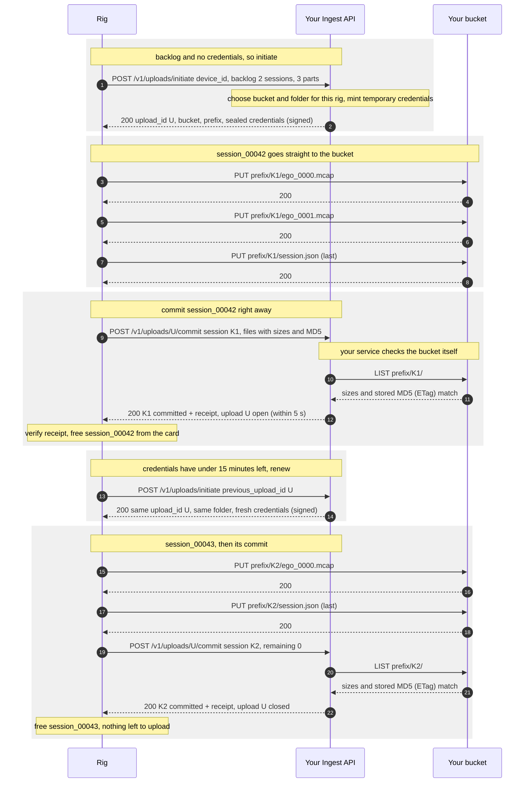

# Visio Ingest API

Protocol `visio-ingest/1`. A rig uploads recordings into a bucket your own
service chooses, with short-lived credentials your service issues, and frees
its card only after your service signs for each session.

## 1. Overview

Visio rigs record to an SD card. Today, a rig can upload its recordings
straight into a bucket you own, using a storage key you configure on the rig.

The **Ingest API** is a second option, for when you want **your own backend to
control the uploads**. You run a small HTTP service with two endpoints, and the
rig works with it like this:

1. **Initiate.** When the rig has recordings to upload and no valid
   credentials, it asks your service where to put them. Your service picks a
   bucket and folder for this rig, and returns temporary credentials that can
   only write into that folder.
2. **Upload.** The rig uploads its recordings **directly** into that folder.
   The files never pass through your service.
3. **Commit.** As each recording finishes uploading, the rig tells your
   service. Your service checks the files in the bucket and replies with a
   signed receipt, and only then does the rig free the space on its card.

This gives you:

- **Per-device routing.** You choose each rig's bucket and folder, and can
  move a rig at any time without touching it.
- **No long-lived storage keys on the rig.** Storage credentials are
  short-lived, limited to one folder, and issued by you.
- **A reliable completion signal.** You learn exactly when each recording has
  landed, with a manifest you can verify.
- **No data loss on flaky networks.** The rig deletes nothing until you have
  signed for it, and resumes after Wi-Fi loss or power loss.

**What you need to run:**
- an HTTPS service with `POST /v1/uploads/initiate` and
  `POST /v1/uploads/{upload_id}/commit`;
- a device key per rig (a key id and a 32-byte secret), which you issue and can
  revoke;
- a way to mint temporary, folder-scoped write credentials for your storage
  (§4.4).

The rig uploads only when it is not recording and is on Wi-Fi, and makes no
calls to your service while recording. It signs every call it makes, and
requires your replies to be signed (§4.2).

---

## 2. Concepts and API

### 2.1 Concepts

| Term | Meaning |
|---|---|
| **Device key** | `key_id` + 32-byte secret, issued by you, one per rig. Every request is signed with it, and your replies are signed with it too. |
| **`device_id`** | The rig's permanent 16-hex hardware serial, e.g. `e54a1de522f7e0f1`. Not the human-readable hostname (`GILABS-…`). Every request is signed by that rig's key, including those the companion app carries for it (§2.3). |
| **Session** | One recording: everything between Start and Stop. It is stored as a folder of parts on the card, e.g. `session_00042-1787776719/`. |
| **Part** | One file of a session, typically an MCAP file of ~256 MB (`ego_0000.mcap`, `ego_0001.mcap`, …). Long sessions have many parts. |
| **`session_key`** | The session's stable identifier: 32 hex characters, random, generated by the rig when recording starts and stored in the session's `session.json`. It doesn't depend on the rig's clock, and is unique across rigs. |
| **Upload** (`upload_id`) | A batch: the folder your service assigned to a rig, plus the temporary credentials for it. One upload holds many sessions, and usually lasts several days across many upload runs. |
| **Folder** | `bucket` + `prefix`, chosen by you. Each session's parts and its `session.json` are written to `<prefix><session_key>/`. |
| **Commit** | The rig telling your service "these sessions are fully uploaded". Your service verifies each one and answers per session. |
| **Receipt** | A per-session signature in the commit response. It proves your service accepted the session. The rig deletes local files only on a valid receipt. |
| **`md5`** | The MD5 of a file, as 32 lowercase hex characters. The rig computes it while sending each file, and it is the only checksum the rig sends. It is the checksum every supported store already keeps for a file uploaded in one PUT (the `ETag`, `md5Hash` or `Content-MD5`), so your service can check it without reading the file. |

### 2.2 The API at a glance

Your service implements **two endpoints**. Between the two calls, the rig talks
only to your bucket.

| | `POST /v1/uploads/initiate` | `POST /v1/uploads/{upload_id}/commit` |
|---|---|---|
| **Purpose** | Tell the rig where to upload, or renew its credentials | Confirm sessions that are fully uploaded |
| **The rig calls it** | When it has something to upload and holds no valid credentials, or its credentials have less than 15 minutes left | As soon as each session's last file lands |
| **The rig sends** | Its `device_id`, its backlog (sessions, files, bytes), the credential types it supports, and its current `upload_id` if it has one | For each session: its `session_key` and its files (recordings and `session.json`) with sizes and MD5; plus what is still left on the card |
| **You return** | An `upload_id`, a bucket and folder, temporary credentials for that folder, and when they expire | For each session: `committed` with a signed receipt, `pending` if you are still checking, or `incomplete`, `invalid` or `conflict`. Always, the upload's id and state (`open` or `closed`) |
| **Full spec** | §4.3 | §4.5 |

**In between**, the rig uploads each file with an ordinary PUT to
`<bucket>/<prefix><session_key>/<file name>`, using the temporary credentials.
Your service is not involved.

**Four rules hold for every call:**

- **Requests are signed.** The rig signs each request with its device key
  (HMAC). No token or secret is ever sent.
- **Replies the rig acts on are signed back** with the same key: the initiate
  response, and each session's commit receipt. The storage credentials inside
  the initiate response are encrypted to the rig.
- **Everything is idempotent.** The rig retries freely after timeouts, Wi-Fi
  drops and power loss, and a repeated call gets the same answer.
- **Answer within 5 seconds.** The rig uploads one file at a time and must not
  be held up waiting for you. If checking a session takes longer, answer
  `pending` and finish the check in the background (§4.5).

### 2.3 Uploads carried by the companion app

Recordings sometimes reach the companion app first (for example when the rig
records straight to the phone), and the app then uploads them itself. It does
so **on the rig's behalf**: the app holds no key of its own, so it asks the
connected rig to sign each request, check each reply and open the sealed
credentials. To your service these calls are indistinguishable from the rig's
own: the same `device_id`, the same key, the same rules.

**Typical volume:** a backlog of 12 sessions in 37 files means 37 uploads to
your bucket, and about 15 small calls to your service: one commit per session,
one `initiate`, and a renewal per hour of uploading. A slow check adds a few
polls, at the interval you set (§4.5).

---

## 3. Workflow

### 3.1 A typical upload

The rig has two finished sessions on its card: `session_00042` (two parts) and
`session_00043` (one part).



The key points:

- **Your service is called a handful of times**, never per file: an initiate
  when the rig has no credentials, one commit per session, and occasionally a
  renewal.
- **Each session is committed as soon as its last file lands** (its
  `session.json`, uploaded after the parts), so you see it right away and the
  rig frees its card space right away.
- **Checking a session is one request:** a `LIST` of its folder returns every
  file's size and stored MD5, which you compare with the commit. No file is
  read back (§4.5).
- **Renewing credentials is just calling `initiate` again**, naming the
  current upload (steps 13–14).
- **`remaining: 0`** on the last commit (step 19) tells you the rig has caught
  up. Here the service closes the batch in its reply (step 22, §3.4); the
  rig's next upload will get a new one.

### 3.2 Upload runs and interruptions

The rig uploads in **runs**: stretches when it is idle and on Wi-Fi. A run ends
whenever a new recording starts, Wi-Fi drops or the rig powers off, and the
next run picks up where it stopped:

| Interruption | What happens next run |
|---|---|
| Mid-file (Wi-Fi drop, recording starts, power loss) | The interrupted file is uploaded again from the start. A half-written object is never left in the bucket. |
| During a call to your service, because a recording started | The rig abandons the call at once (it makes no network calls while recording) and repeats it next run. Calls are idempotent, so nothing is lost. |
| After a file landed, before the rig recorded that it did | The rig uploads it again with a "create only if absent" condition. Where the cloud honours that, the existing file is kept; where it doesn't, the same bytes are written again. Either way, the commit decides. |
| After a commit was sent, before the reply arrived | The rig re-sends the commit. Commits are idempotent: same answer, same receipt. |
| After your service created an upload, before the reply arrived | The rig calls `initiate` again. Your service should return the upload it already created (§4.3). |

Nothing is deleted from the card until a receipt arrives, so no interruption
loses data. The worst case is re-sending one file.

### 3.3 Credentials

Credentials are short-lived (at least 30 minutes, usually hours); an upload
lives for days. The rig keeps its current credentials in memory across runs,
and calls `initiate` only when it needs to:

- it has something to upload and holds no valid credentials (after a reboot,
  a reconfiguration, or a `404`/`410`);
- before starting a file, the credentials have **less than 15 minutes** left;
- once, if the bucket rejects the credentials.

It does **not** call `initiate` on every run or for every file, and never when
it has nothing to upload. With 1-hour credentials it typically renews once
every ~45 minutes of uploading.

To renew, the rig sets `previous_upload_id` to its current upload. Your service
returns **the same `upload_id` and folder**, with fresh credentials.

The rig has no trustworthy wall clock, so it reads `credentials_expire_at`
against the `Date` header of the same response: only the remaining lifetime
matters.

### 3.4 Batches: when an upload ends

There is no "batch finished" call. Each session is complete when its commit
succeeds, and that is the only signal your service has to act on. Every
commit also reports what is **still left on the card** (`remaining`). When it
reaches zero, the rig has caught up.

How long a batch stays open is **your choice**, and every commit response
tells the rig where it stands: `upload.state` is `open` or `closed` (§4.5).

- **Long-lived batches** (e.g. one per rig per day or per project): keep
  answering `open`, and keep returning the same `upload_id` from `initiate`.
  Later recordings join the same folder.
- **One batch per backlog:** when a commit reports `remaining.sessions == 0`,
  answer it with `upload.state: "closed"`. The rig drops its credentials and
  starts no new session under that upload; its next `initiate` gets a new
  `upload_id` and a new folder.

You can close a batch on any commit, not only the last one. A closed upload
must still accept commits for sessions whose files are already in its folder,
until it expires.

### 3.5 Moving a rig to another bucket

- **To move it at once,** answer its next commit with `upload.state:
  "closed"`. The sessions in that commit are still committed normally; the rig
  then drops its credentials and calls `initiate`, and you return the new
  folder.
- **To move it at its next renewal,** return a **new `upload_id`** (with the
  new folder) from `initiate`.

New sessions go to the new folder. Sessions whose files are all already
uploaded are still committed under the old `upload_id`. A session that was
only partly uploaded is restarted in the new folder; nothing is lost, because
nothing is deleted before commit.

---

## 4. API reference

### 4.1 Conventions

- **Base URL:** whatever you configure on the rig (§5), e.g.
  `https://ingest.example.com/visio`. All paths below are relative to it.
- **Bodies:** JSON, UTF-8.
- **Response size:** at most 64 KiB (the rig's memory limit).
- **Response time:** answer within **5 seconds**. The rig treats any call,
  `initiate` included, with no answer after 10 seconds as failed, and retries
  it in its next upload run. For commits, answer `pending` rather than make the
  rig wait (§4.5).
- **`Date` header:** required on **every** response, including errors. The
  rig corrects its clock from it (§4.2) and reads credential expiry against it
  (§3.3).
- **Errors:** a non-2xx status with this body:

  ```json
  { "error": { "code": "upload_closed", "message": "Shown to the operator in the app", "retryable": false } }
  ```

  The rig acts on `code` (§4.6). `message` is shown in the companion app, so
  make it say how to fix the problem.

### 4.2 Authentication

#### Requests: signed with the device key

Every request carries:

```
X-Visio-Date:           20261009T031522Z          the rig's clock, UTC
X-Visio-Content-SHA256: <hex SHA-256 of the body>
Authorization:          VISIO-HMAC-SHA256 Credential=<key_id>, Signature=<hex>
```

```
string_to_sign = "VISIO-HMAC-SHA256" + "\n"
               + X-Visio-Date          + "\n"
               + key_id                + "\n"
               + HTTP method           + "\n"    uppercase
               + path                  + "\n"    as sent, including the base path
               + canonical query       + "\n"    sorted k=v joined by "&"; empty if none
               + X-Visio-Content-SHA256

signature = hex( HMAC-SHA256( base64url_decode(secret), string_to_sign ) )
```

The body hash covers only the small JSON request body, never a recording.

To verify a request:
1. Look up the secret for `key_id`.
2. Recompute the signature, and compare in constant time.
3. Check that `X-Visio-Content-SHA256` matches the body.
4. Check that the `device_id` in the body is the device this key belongs to
   (otherwise `403 device_mismatch`).

**Clock:** accept `X-Visio-Date` within ±15 minutes of your own clock. Outside
that, answer `401 clock_skew`. The rig re-reads your `Date` header and signs
again. Rigs have no network time source, so expect this on the first request
after a rig has been powered off for a while.

A reference implementation ships with `pip install visio-schema` as
`visio_schema.ingest` (signing, receipts, sealed credentials), and
`tests/golden/ingest_vectors.txt` holds cross-language test vectors for every
construction in this section.

#### Responses: signed back to the rig

The rig does **not** rely on TLS certificate validation: it has no
trustworthy clock to check a certificate's validity. These signatures are what
stop an interceptor from redirecting the rig to another bucket or making it
delete data, so they are **required**:

| Reply | Where the signature goes | String signed |
|---|---|---|
| `initiate` | header `X-Visio-Signature` | `"VISIO-UPLOAD\n" + device_id + "\n" + <the request's X-Visio-Date> + "\n" + hex(SHA-256(response body))` |
| each committed session | `receipt` field of that session's entry | `"VISIO-COMMIT\n" + device_id + "\n" + upload_id + "\n" + session_key + "\n" + content_digest` |

Both use `hex(HMAC-SHA256(base64url_decode(secret), string))`. An unsigned or
wrongly signed reply is treated as a failed request and retried. In
particular, the rig keeps its files.

#### Storage credentials: sealed to the rig

The secret half of the storage credentials is encrypted so that only the rig
can read it:

```
key       = HKDF-SHA256(ikm = base64url_decode(device secret), salt = "",
                        info = "visio-ingest upload v1", length = 32)
nonce     = 12 random bytes
plaintext = JSON, see §4.4
aad       = device_id + "\n" + upload_id
sealed    = base64url( nonce || ChaCha20-Poly1305(key, nonce, plaintext, aad) )
```

The rig keeps decrypted credentials in memory only, never on its storage.

### 4.3 `POST /v1/uploads/initiate`

Starts an upload, continues an existing one, or renews its credentials.

**Request**

```json
{
  "device_id": "e54a1de522f7e0f1",
  "device_kind": "ego",
  "hostname": "GILABS-AU3LTGoD",
  "app_version": "1.4.2",
  "destination_hint": "",
  "recording_key_fingerprint": "",
  "sessions": 12,
  "parts": 37,
  "bytes": 9876543210,
  "card_free_bytes": 51539607552,
  "credential_types": ["static", "session_token"],
  "previous_upload_id": "up_01J9Z4QX",
  "test": false
}
```

| Field | Type | Meaning |
|---|---|---|
| `device_id` | string | The rig's 16-hex serial. Must belong to the signing key. |
| `device_kind` | string | Rig model, e.g. `"ego"`. |
| `hostname`, `app_version` | string | For your logs and UI. |
| `destination_hint` | string | Free text the operator configured on the rig (e.g. a project name), or empty. An input to your routing, nothing more. |
| `recording_key_fingerprint` | string | Set if the rig encrypts its recordings; identifies the key. Empty otherwise. |
| `sessions`, `parts`, `bytes` | int | The rig's upload backlog as its upload queue knows it at this moment, for routing and quota decisions. Informational: a run may be cut short. |
| `card_free_bytes` | int | Free space on the card. |
| `credential_types` | string[] | Credential forms this rig supports (§4.4). Current rigs send `static` and `session_token`; `azure_sas` is listed by later versions. |
| `previous_upload_id` | string or null | The rig's current upload, if it still has one. `null` on first use, after the upload expired, after `404`/`410`, or after the rig was re-provisioned. |
| `test` | bool | `true` when an operator presses **Test** in the app. Don't create an upload or mint credentials. Just confirm the key and the routing. |

**Response:** `200`, with header `X-Visio-Signature`

```json
{
  "protocol": "visio-ingest/1",
  "server": "acme-ingest/2.3.0",
  "upload_id": "up_01J9Z4QX",
  "expires_at": "2026-10-16T03:15:22Z",
  "storage": {
    "endpoint_url": "https://oss-ap-southeast-1.aliyuncs.com",
    "region": "ap-southeast-1",
    "bucket": "acme-site-b-recordings",
    "prefix": "rigs/e54a1de522f7e0f1/up_01J9Z4QX/",
    "access_key_id": "STS.…",
    "sealed": "<base64url>",
    "credentials_expire_at": "2026-10-09T06:15:22Z"
  }
}
```

| Field | Meaning |
|---|---|
| `upload_id` | Your id for this batch: ≤ 64 characters of `[A-Za-z0-9_-]`, and never the literal `initiate`. `null` for a `test` request. |
| `expires_at` | When the upload stops accepting new files and commits. Recommended: at least 7 days out. |
| `storage.endpoint_url` | The storage endpoint. The rig works out the cloud from its host name (`*.aliyuncs.com`, `*.myqcloud.com`, `*.blob.core.windows.net`, `storage.googleapis.com`, otherwise S3). |
| `storage.bucket`, `storage.prefix` | The folder. `prefix` is empty or ends in `/`. |
| `storage.access_key_id`, `storage.sealed` | The credentials (§4.4). `sealed` is omitted for a `test` request. |
| `storage.credentials_expire_at` | When the credentials stop working: **at least 30 minutes** after the response's `Date`, usually 1–12 hours. The rig reads it against `Date` (§3.3). |

**Rules for your service**

- **Continue or create.** If `previous_upload_id` is still valid for this rig,
  normally return the same `upload_id` and folder, with freshly minted
  credentials. Return a new one only when you want to move the rig or close
  the batch (§3.4, §3.5).
- **`null` means "continue or create".** If the rig already has an open upload
  you would still route it to, return that one instead of creating another.
  This covers a lost reply: if the rig never received your last response, it
  retries without the id.
- **Credential type:** issue one of the types the rig listed. If you can't,
  answer `409 no_compatible_storage`.
- **Busy or full:** `503` with `Retry-After` (seconds) to defer, or
  `507 quota_exceeded`.

### 4.4 Storage credentials and permissions

`sealed` decrypts to one of these, matching an entry in `credential_types`:

| Type | Decrypted `sealed` | Typical source |
|---|---|---|
| `session_token` | `{"secret_access_key": "…", "session_token": "…"}` | AWS STS, Aliyun STS, Tencent STS, Cloudflare R2 temporary credentials |
| `azure_sas` | `{"sas": "sv=…&sig=…"}` | An Azure container SAS with create + write permission |
| `static` | `{"secret_access_key": "…"}` | A long-lived key. Avoid it if your cloud supports one of the above; it is currently the only option for Google Cloud Storage. |

**Grant write-only access to the folder.** For example, on AWS: `s3:PutObject`
on `arn:aws:s3:::<bucket>/<prefix>*`; on Aliyun: `oss:PutObject` on
`acs:oss:*:*:<bucket>/<prefix>*`.
- The rig never lists, reads or deletes in your bucket.
- It may overwrite a file of its own: it re-sends a file you reported as
  `mismatched` (§4.5).

**Object layout:** one folder per session, holding its recording files and,
uploaded last, its `session.json`:

```
<prefix><session_key>/ego_0000.mcap
<prefix><session_key>/ego_0001.mcap
<prefix><session_key>/session.json
```

For example: `rigs/e54a1de522f7e0f1/up_01J9Z4QX/8f1c…/ego_0000.mcap`.

**Two settings keep checking fast.** Your service checks files by the MD5 the
store keeps (§4.5), which requires that:
- each file is uploaded in a single PUT, which is how the rig uploads (a
  multipart upload's `ETag` is not an MD5);
- on AWS S3, the ingest bucket does not use SSE-KMS or customer-provided-key
  encryption, under which the `ETag` is not an MD5 either. Default encryption
  (SSE-S3) is fine.

**"Create only if absent" is best effort.** The rig sends each first attempt
with the cloud's no-overwrite condition (`If-None-Match: *`,
`x-oss-forbid-overwrite`, `x-cos-forbid-overwrite`, …). It only stops an
existing file being overwritten; the rig may still send the file's bytes
before the store refuses. Some S3-compatible stores ignore the condition, and
object versioning switches it off on Aliyun OSS and Tencent COS. Correctness
never depends on it, only on the commit check.

### 4.5 `POST /v1/uploads/{upload_id}/commit`

Tells your service that one or more sessions are fully uploaded. The rig
commits each session as soon as its last file lands. It sends several in one
request only when they are already waiting: after an interrupted run, or when
a session was answered `pending` and is being sent again. Up to 32 sessions
per request.

**Request**

```json
{
  "device_id": "e54a1de522f7e0f1",
  "sessions": [
    {
      "session_key": "8f1c2a0b9d3e4f5a6b7c8d9e0f1a2b3c",
      "session": "session_00042-1787776719",
      "parts": [
        { "name": "ego_0000.mcap", "bytes": 268435456,
          "md5": "5f0c2b1e…" },
        { "name": "ego_0001.mcap", "bytes": 201326592,
          "md5": "a81d77c4…" }
      ],
      "metadata_file": { "name": "session.json", "bytes": 812,
                         "md5": "3c94e0a6…" }
    }
  ],
  "remaining": { "sessions": 0, "parts": 0, "bytes": 0 }
}
```

| Field | Meaning |
|---|---|
| `session_key` | The session's id (32 hex characters). Files are under `<prefix><session_key>/`. |
| `session` | The folder name on the rig's card, for humans. Not unique across cards. |
| `parts` | Every recording file of the session, in name order, with size and `md5`. |
| `metadata_file` | The session's `session.json`, uploaded to the same folder after the parts, with its size and `md5`. Always present. |
| `remaining` | What is still on the card and not yet committed, after this request. `sessions: 0` means the rig has caught up. |

**A file's `md5` may be missing.** This is rare: it happens when the rig
could not compute it this time, for example a file confirmed by an earlier run
whose checksum was lost to a power cut. The rig does not read up to 256 MB
again just to compute it. Check the size, and use the MD5 your storage
reports.

**What your service checks, per session**

**List the session's folder once** (`<prefix><session_key>/`). Every store's
list response gives each object's size and stored MD5, so one request covers
the whole session:

| Store | Stored MD5 in the list response |
|---|---|
| AWS S3, Cloudflare R2, MinIO, Aliyun OSS, Tencent COS | `ETag` (hex, in quotes; OSS uses upper case) |
| Google Cloud Storage | `md5Hash` (base64) |
| Azure Blob | `Content-MD5` (base64) |

Then, for each listed file, the parts and `metadata_file`:

1. It exists with the declared size (**required**).
2. Its stored MD5 equals the declared `md5` (**required** when `md5` is
   present).

A missing or different file, `session.json` included, makes the entry
`incomplete`. The rig deletes its copy once you sign, so this is your last
chance to catch a corrupted file.

**If a check can't finish within 5 seconds**, answer `pending` for that
session, with `retry_after_seconds` (how long you expect the check to take),
and finish it in the background. The rig moves on to its next upload
and sends the session again with its next commit. With the MD5 comparison this
should be rare: it is for stores that hold no MD5 (an S3 bucket with KMS
encryption, for example), where you must read the files back.

The commit is a manifest only. The session's metadata is in its
`session.json`, in the same folder.

**Response:** `200`, one entry per session in request order, and always the
state of the upload

```json
{
  "upload": { "upload_id": "up_01J9Z4QX", "state": "open" },
  "sessions": [
    {
      "session_key": "8f1c2a0b9d3e4f5a6b7c8d9e0f1a2b3c",
      "state": "committed",
      "content_digest": "3852d3f8…",
      "disposition": "accepted",
      "receipt": "a91b…"
    },
    {
      "session_key": "a03e7712c4d5e6f708192a3b4c5d6e7f",
      "state": "incomplete",
      "missing": ["ego_0002.mcap"],
      "mismatched": []
    }
  ]
}
```

| `state` | When | What the rig does |
|---|---|---|
| `committed` | All checks passed. Include `content_digest`, `disposition` (`accepted` or `duplicate`) and `receipt`. | Verifies the receipt, then deletes the session from its card |
| `pending` | You are still checking. Include `retry_after_seconds`. | Moves on to its next upload, and sends the session again with its next commit. With nothing else to send, it waits `retry_after_seconds` (30 if absent), doubling the wait on each further `pending` up to 5 minutes, and only while it is idle and on Wi-Fi. The session's files stay on the card until you sign. |
| `incomplete` | Files missing or different. List them in `missing` / `mismatched`. | Uploads those files again, overwriting any mismatched ones, then commits again. You don't need to delete anything. |
| `invalid` | Malformed entry. Include `message`. | Marks the recording failed, keeps its files, and shows `message` in the app |
| `conflict` | This `session_key` was already committed with a different manifest. Include `message`. | Same as `invalid` |

**`upload` is always present.** It names the upload this commit was made
under, and its state as of this reply:

| `upload.state` | Meaning | What the rig does |
|---|---|---|
| `open` | The batch continues | Keeps its credentials and keeps uploading into this folder |
| `closed` | You have closed the batch. The sessions in this request are still handled as their entries say. | Drops its credentials and starts no new session under this upload. On its next upload it calls `initiate`, and gets the new upload you return. Sessions whose files are all already in this folder are still committed here. |

A `closed` here is the normal way to end a batch (§3.4) or to move a rig at
once (§3.5). It differs from `410 upload_closed` (§4.6), which also refuses the
commit itself.

`content_digest` is computed by **your service**: the hex SHA-256 of the
lines `"<name>:<bytes>:<md5>\n"` for each part, in name order, using the values
you checked. It covers the recording files only, not `session.json`,
and it identifies duplicate recordings.

**Each session stands alone.** One bad session never blocks the others in the
same request. **Commits are idempotent:** committing the same session again
returns the same entry and the same receipt.

**A receipt is custody.** Once you return a receipt, the rig deletes its only
copy of that session. Don't later report a session you have signed for as
missing.

**Accept every session**: duplicates, very short ones, ones with no operator,
ones with a bad clock, and ones whose last part is truncated because the rig
lost power while recording. Sort them out, and repair what you can,
afterwards. A rig cannot re-record footage you refused.

**Clean up what is never committed.** Files of a session that is never
committed stay in the folder; once the upload expires, removing them is up to
you. The rig's credentials cannot delete.

### 4.6 Error codes

| Status | `code` | When | The rig |
|---|---|---|---|
| 401 | `clock_skew` | `X-Visio-Date` off by more than 15 min | Fixes its clock from `Date`, retries once |
| 401 | `bad_signature`, `unknown_key` | Signature or key invalid | Stops uploading until re-provisioned |
| 403 | `device_mismatch`, `revoked`, `forbidden` | Key not valid for this device or action | Stops uploading until re-provisioned |
| 404 | `upload_unknown` | No such `upload_id` | Drops its credentials, calls `initiate` again |
| 409 | `no_compatible_storage` | No credential type in common | Reports it, tries again next run |
| 410 | `upload_closed` | The upload has expired, or you will accept nothing more under it, not even this commit. To end a batch normally, answer `200` with `upload.state: "closed"` instead (§4.5). | Drops its credentials and calls `initiate`; re-uploads the sessions in this commit, and any unfinished ones, to the new folder |
| 422 | `too_many_sessions` | More than 32 sessions in one commit | Commits in smaller groups |
| 429 / 503 | any | You're busy; send `Retry-After` | Waits, then retries |
| 507 | `quota_exceeded` | Out of quota | Pauses uploads for an hour; shows it in the app |
| 5xx | any | Server error | Retries with backoff |

---

## 5. Setting up a rig

The operator configures the rig with a **settings QR code** scanned in the
companion app. You generate it with `visio-settings-qr`, which comes with
`pip install visio-schema`. The QR carries the device key **sealed**, so
neither the QR image nor the phone can reveal it.

| Field | Value |
|---|---|
| Endpoint | `visio+https://ingest.example.com/visio`. The `visio+` prefix tells the rig this is an Ingest API, not a bucket. |
| Device key ID | Your `key_id` for this rig |
| Device key secret | The 32-byte secret, base64url (43 characters), sealed inside the QR |
| Destination (optional) | Free text, passed to you as `destination_hint` |

For development, the same fields can be typed on the app's cloud upload screen,
where the key is entered in plain text.

**Recordings made before the upgrade** carry no `session_key` in their
`session.json`. Their key is derived instead:
`hex(SHA-256(device_id + "\n" + session folder name))[:32]`, so it is
equally stable.

**Test** sends `initiate` with `"test": true`. A green result confirms the
endpoint, the key, the clock and your routing decision. Bucket permissions are
first exercised by the first real upload. Test is unavailable while the rig is
recording.

---

## 6. FAQ

**Why doesn't the rig upload through the API instead?**
A rig records roughly 10 GB per hour. Passing that through your service would
mean carrying every byte twice (in from the rig, then out to storage), and
sizing your service for it. Uploading straight to the bucket keeps your service
small, while you still decide where every file goes.

**If the rig has credentials for the bucket, why does it call `commit` at all?**
Two reasons. First, it gives you a definite "complete" signal with a manifest,
so you never have to watch the bucket or guess whether an upload has finished.
Second, the rig must not delete its only copy on the bucket's word alone. It
waits for your signed receipt, which you issue after checking the files.

**Checking a session takes me a while. Will the rig wait?**
No. Answer within 5 seconds; if the check needs longer, answer `pending`. The
rig keeps uploading while you check, sends the session again with its next
commit, and frees it once you sign. Making it wait would slow its uploads,
because it uploads one file at a time.

**Why MD5, and not SHA-256?**
Because it is the checksum every supported store already keeps, so you check a
whole session with one `LIST` and never read a file back. The rig computes it
while sending each file, with no second read, and sends no other checksum: one
pass over each byte is all its small embedded processor spends. A SHA-256
would only be stored by S3, and only if the rig hashed every 256 MB file
before sending it, a full extra read. MD5 is not collision-proof between two
files an attacker crafts together, but matching the MD5 of a file the rig
already sent remains infeasible, which is what this check relies on.

**How can credentials last hours while an upload lasts days?**
They are separate things. The upload is a record in your service: this rig,
this folder. The credentials are issued by your cloud, with an expiry built in.
Whenever they are close to expiring, the rig calls `initiate` again with the
same `upload_id`, and you mint fresh credentials for the same folder. A leaked
credential is therefore worth a few hours and one folder.

**How often does the rig call `initiate`?**
Only when it has something to upload and no valid credentials (for example
after a reboot), or when its credentials have less than 15 minutes left. Not
per file, and not every time it reconnects to Wi-Fi.

**Do I need a separate "batch finished" endpoint?**
No. Each commit completes its sessions, and `remaining` tells you when the rig
has caught up. To close the batch, answer that commit with
`upload.state: "closed"` (§3.4).

**How do I tell the rig a batch is closed?**
In any commit response: `upload.state: "closed"`. Every commit response carries
the upload's id and state, so the rig always knows whether to keep uploading
into the current folder or to ask `initiate` for a new one.

**What if the rig loses power or Wi-Fi mid-upload?**
Nothing is lost. The interrupted file is sent again from the start in the next
run, and everything already uploaded is skipped or confirmed. See §3.2.

**What if the rig lost power while recording?**
The session's last part may be cut short. The rig uploads it as it is, and the
session is committed like any other. Accept it, and repair the truncated part
on your side if you need it.

**What if the same recording is uploaded twice?**
`content_digest` identifies identical content. Answer `committed` with
`disposition: "duplicate"`, and handle it on your side. Don't reject it.

**Can I trust the recording's start time?**
Not always. `start_time_unix` in `session.json` comes from the rig's clock, and
rigs without a set clock record times in 1970 or 2021. Treat values below
1,000,000,000 as unknown, and use the commit time instead if you need a date.

**Which clouds are supported?**
AWS S3 and S3-compatible stores (including Cloudflare R2 and MinIO), Aliyun
OSS, Tencent COS and Azure Blob, all with short-lived credentials. Google Cloud
Storage currently needs a long-lived HMAC key (`static`), because GCS cannot
issue short-lived ones in the form the rig uses (§7).

**Why the custom signature instead of a bearer token or OAuth?**
The rig has no reliable clock and very little memory, and it must not leak a
reusable secret even if a connection is intercepted. HMAC signing never sends
the secret. Because the rig can't rely on TLS certificate checks, your replies
are signed too, so an interceptor can't redirect the rig to another bucket or
make it delete data. Storage credentials are encrypted to the rig, so an
interceptor can't read them either.

**Are the recordings themselves protected in transit?**
They travel over HTTPS to your bucket. For end-to-end protection, enable
recording encryption on the rig: files are then encrypted on the rig before
upload (`recording_key_fingerprint` tells you which key).

**Does the rig send health or telemetry to this API?**
No. This API is only for uploading finished recordings. In ingest mode the rig
also writes no status files into your bucket; it writes only recordings and
their `session.json`.

**What identifies a recording on my side?**
Use `session_key` (with `device_id`). Any id you assign internally stays
internal; the rig doesn't need it.

---

## 7. Open questions for reviewers

1. **Google Cloud Storage.** GCS has no short-lived HMAC keys, and its grants
   apply to a whole bucket. Would you accept a dedicated service account per
   rig or per batch? Or would you rather we added per-file signed URLs, at the
   cost of one extra API call per file?
2. **Re-sending large files.** An interrupted file is re-sent from the start
   (up to ~256 MB, about 45 seconds at typical Wi-Fi rates). Is that
   acceptable on your networks, or do you need resume within a file (multipart
   upload)?
