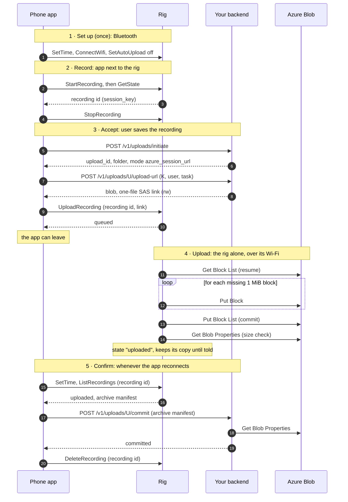

# Session upload to Azure: one resumable tar file per recording

Status: implemented on the rig and in the companion app; the rig commands
are specified in [`archive_upload.md`](archive_upload.md). Designed
2026-11-06; the Azure mechanisms it relies on were validated against the
Azure Blob service (section 12). The backend API (section 9) is the part
each integrator builds.

## 1. Summary

- Each recording is uploaded as **one file** in Azure Blob Storage: a
  standard, uncompressed tar archive holding the recording's MCAP files and
  its `session.json`.
- **The rig talks only to the phone app, over Bluetooth.** The app talks to
  your backend, which issues a **one-file upload link** (a SAS URL scoped to
  that single blob). The app hands the link to the rig, and **the rig uploads
  directly to Azure** over its own Wi-Fi. The recording never passes through
  the phone.
- **The backend API follows the Visio Ingest API (`visio-ingest/1`)**: the
  same `initiate` and `commit` endpoints and bodies, plus one endpoint for
  the per-recording link and an archive form of `commit`. Your app calls it
  with your own app authentication; the rig signs nothing and holds no keys
  (section 9).
- **Bluetooth is treated as intermittent.** The phone is needed only to
  start and stop recordings, to hand over a link, and later to confirm and
  delete. Once the rig has a link, it uploads on its own, across new
  recordings, network drops and power loss.
- The tar is **never built on the rig**. The rig streams each recording file
  into the blob as Azure *blocks*, and a final commit turns the blocks into
  the archive. The archive appears in the container **only when complete**.
- **Uploads resume** after any interruption using Azure's block blob
  feature: blocks Azure already holds are not sent again. An interruption
  costs at most one block (1 MiB). This requires the link to grant **read**
  as well as **write** (`rw`, section 9.5).
- The rig keeps every recording on its SD card until the app tells it to
  delete it, after your backend has confirmed the upload.

## 2. Requirements

| Requirement | How it is met |
|---|---|
| One file per recording | one tar blob per recording (section 4) |
| Rig talks only to the phone app, over Bluetooth | all control and every backend call go through the app (sections 5, 6) |
| Upload through a presigned link from your backend | one-file SAS link per recording, handed to the rig by the app (section 9) |
| Backend close to the existing Visio Ingest API | same `initiate` and `commit` endpoints and bodies; one endpoint added; authenticated by your app (section 9) |
| No device registration or keys on the rig | the rig signs nothing; your backend authenticates the app (section 9.1) |
| Recordings and links private in transit | the rig verifies Azure's TLS certificate chain and host name (section 8.1) |
| Phone not needed during the upload | the rig owns each upload job and persists it (section 7) |
| Survive interruptions without starting over | Azure block blob resume (section 10) |
| Readable with standard tools | plain POSIX tar; each member is a normal MCAP file or JSON (section 4) |

## 3. Recording on the rig (unchanged)

The rig records a session as a sequence of MCAP files ("parts") of up to
256 MiB each, plus a `session.json` written when the recording stops. Each
part is a complete, standalone MCAP file.

A recording's **recording id** is its **`session_key`**: 128 random bits
as 32 lowercase hex, generated by the rig when the recording starts and
written into every part's MCAP metadata and into `session.json`. It is
unique across rigs and survives card swaps and reformatting. The app, the
rig commands, your backend and the archive name all use it.

The recording also has a **session name** (its folder on the SD card, e.g.
`session_00042-1787776719`), which is only a human-readable label: it is
not unique across rigs.

Recording in parts is deliberate: a power loss during a recording affects
only the part being written, every finished part is already safe on the SD
card, and no single file grows beyond what the rig's storage handles well.
Packaging into one file happens at upload time, not at recording time.

If one MCAP file per recording is needed downstream, the parts can be merged
after download (`mcap merge`). Parts cannot simply be concatenated.

## 4. Archive format

```
<prefix><session_key>.tar
├── <session_key>/part_0000.mcap     tar header │ MCAP data │ padding
├── <session_key>/part_0001.mcap     tar header │ MCAP data │ padding
├── …
├── <session_key>/session.json       tar header │ JSON      │ padding   (always last)
└── end-of-archive marker            1024 zero bytes
```

- Format: POSIX tar, ustar headers (readable by GNU tar, bsdtar, 7-Zip,
  Python `tarfile`, …). Uncompressed: the video in MCAP is already
  compressed, so compressing the archive would cost rig CPU for little gain.
- Blob name: `<prefix>` is the folder your backend assigns in `initiate`
  (section 9.2).
- Member names: `<session_key>/` followed by the recorder's file names.
- Every file is stored exactly as on the SD card. A recording made with a
  recording key is encrypted on the card (VREC), and its archive member is
  that ciphertext: the rig never decrypts, and does not need to hold the key
  to upload it. Decryption happens only in your backend, which holds the key.
- `session.json` is the last member, byte for byte the file on the SD card.
  The archive carries no index of its own: your backend receives every
  file's offset and size in `commit` (section 9.4), and a reader with only
  the blob can walk the tar headers with small range requests.

Reading the archive:

```bash
tar -tvf <archive>.tar                 # list
tar -xf  <archive>.tar                 # extract everything
# one part, without downloading the archive: take its data_offset and bytes
# from commit, then GET the blob with  Range: bytes=<data_offset>-<data_offset+bytes-1>
```

## 5. Roles and flow

| Party | Talks to | Does |
|---|---|---|
| Phone app | rig (Bluetooth), your backend (internet) | controls recording; calls your backend; hands the link to the rig; tells the rig to delete |
| Rig | phone app (Bluetooth), Azure (its own Wi-Fi) | records; uploads to Azure on its own; keeps recordings until the app tells it to delete them |
| Your backend | phone app | assigns the folder, issues one-file links, confirms uploads |
| Azure Blob Storage | rig (upload), your backend (checks) | stores the archive |

### 5.1 Message flow



All calls to your backend are made by the app with your app
authentication. `initiate` is needed only when the app holds no open upload
for this rig: one upload (`upload_id`, a folder) lasts days and holds many
recordings. `U` is the `upload_id`, `K` the recording's `session_key`. The
app sets the rig's clock (`SetTime`) each time it connects; the rig needs a
correct clock to check Azure's certificate (section 8.1).

## 6. Rig interface for the upload (app ↔ rig over Bluetooth)

The upload uses these commands of the rig's existing Visio command set
(`visio-schema`), which runs over the Bluetooth control link:

| Purpose | Command | Status |
|---|---|---|
| Set up: upload only when told | `SetAutoUpload { enabled: false }` | existing |
| On every connect: set the rig's clock | `SetTime` | existing |
| Hand over the link | `UploadRecording` | **new** |
| Upload state and progress | `ListRecordings { session_key }` → `RecordingEntry` | existing, extended |
| Stop an upload | `CancelUpload` | **new** |
| Delete after your backend confirmed the upload | `DeleteRecording { session_key }` | existing, extended |

The app learns a recording's id (`session_key`) from `DeviceState`
(`recording_session_key` while it records, `last_recording_stop.session_key`
after it stops) or from `ListRecordings`. Progress is read by polling
`ListRecordings` while connected; there is no separate event stream.

**New commands**

```proto
// Hand a recording's one-file link to the rig. Accepted only inside the
// encrypted Bluetooth session. The rig queues the upload and keeps the link
// on its internal storage until the upload ends.
message UploadRecording {
  string session_key = 1;  // the recording id
  string url         = 2;  // the one-file SAS URL from upload-url (section 9.3)
}

// Stop a recording's upload and forget its link. Blocks already in Azure
// stay there until Azure discards them (section 10).
message CancelUpload {
  string session_key = 1;  // the recording id
}
```

`UploadRecording` is refused with the existing codes `no_such_session` (no
recording with that `session_key`), `active_session` (the recording is still
running), `invalid_request` (not an HTTPS Azure blob URL) and `unsupported`.

**Extensions to existing messages** (additive; older apps ignore them):

| Message | Addition |
|---|---|
| `RecordingEntry.UploadState` | `UPLOAD_STATE_NEEDS_LINK`: Azure rejected the link |
| `RecordingEntry` | `session_key`, `upload_blob` (the blob name), `archive_bytes` |
| `RecordingFile` | `md5` and `archive_offset` (where the file's data starts in the archive), filled once uploaded |
| `DeviceState` | `recording_session_key`, and `archive_upload_supported` (the capability flag an app checks before offering this mode) |
| `RecordingStop` | `session_key` of the recording that stopped |
| `ListRecordings`, `DeleteRecording` | an optional `session_key`, accepted in place of `session_name` |

The rig mints a `session_key` for every recording. Today it does so only
when its upload destination is an Ingest API, so this is a firmware change.

Upload states, as `ListRecordings` reports them:

| `UploadState` | Meaning | What the app does |
|---|---|---|
| `NONE` | no upload requested | nothing, until the user saves |
| `PENDING` | has a link; waiting (a recording is running, no Wi-Fi, no valid clock, or the certificate check failed; `last_error` says which) | nothing; it sends `SetTime` on connect anyway |
| `IN_FLIGHT` | blocks being sent | shows progress |
| `NEEDS_LINK` (new) | Azure rejected the link (expired or revoked) | requests `upload-url` again (`reason: needs_link`) and sends `UploadRecording` |
| `COMPLETED` | archive committed and size-checked; local copy kept | sends `commit`; when your backend answers `committed`, sends `DeleteRecording` (unless the app's *Delete from device after upload* switch is off) |
| `FAILED` | a permanent error (`last_error`), e.g. the blob exists and the link cannot overwrite it | shows the error; your backend decides (a fresh link that may replace it, or give up) |

Rules:

- `UploadRecording` is accepted for any finished recording at any time,
  including while another recording is running (it is queued). Repeating it
  is safe: a fresh link for the **same blob** replaces the old one and the
  upload continues where it stopped.
- `DeleteRecording` is refused while an upload of that recording is in
  progress; `CancelUpload` it first. Encrypted recordings, which the rig
  otherwise keeps from any delete, can be deleted once their upload is
  `COMPLETED`: every part is then in the blob.
- A link is a credential: the rig accepts `UploadRecording` over Bluetooth
  only inside the encrypted session.

## 7. Designed for intermittent Bluetooth

The phone may disconnect at any point: the user walks away, the operating
system suspends the app, or the connection drops. The design does not
require the Bluetooth connection to be long-lived:

- **The rig owns each upload job.** `UploadRecording` creates a job (the
  recording and its link) that the rig stores on its internal storage, so
  the upload continues across Bluetooth disconnects, new recordings, network
  drops and power loss, without the phone.
- **State lives on the rig, not in events.** Whenever the app connects, it
  syncs with `ListRecordings` and acts on each recording's state
  (section 6): commit and delete `COMPLETED` recordings, refresh links for
  `NEEDS_LINK`, report `FAILED`.
- **Every command and every API call is idempotent**, so an app that lost a
  reply simply sends it again.
- **The rig never deletes on its own.** A recording leaves the SD card only
  on `DeleteRecording`, which the app sends after your backend confirmed the
  upload (and only while its *Delete from device after upload* switch is on). If the app does not come back, the recording stays safe on the
  card; `DeviceState.disk_free_pct` lets the app prompt the user.
- **The phone is needed only** to start and stop recordings, to hand over a
  link, and to confirm and delete. None of these needs a continuous
  connection.

Platform notes for the app: reconnecting is initiated by the phone (the rig
advertises continuously and accepts a reconnect at any time, one phone at a
time). Background Bluetooth is limited by the phone's operating system
(iOS background modes, Android foreground services and battery managers,
HarmonyOS continuous tasks), which is why this design never relies on the
app staying connected.

## 8. Upload mechanism

Azure block blobs are assembled from **blocks** (up to 50,000 per blob).
Blocks can be uploaded in any order and at any time; the blob only comes
into existence when a final *commit* lists the blocks in order. The rig maps
the tar layout onto blocks:

| Block | Size |
|---|---|
| tar header of a member | 512 bytes to a few KiB |
| member data | 1 MiB each (the last one shorter) |
| padding to a 512-byte boundary | 0–511 bytes (omitted when 0) |
| end-of-archive marker | 1024 bytes |

Azure REST operations used, all on the single blob URL:

| Operation | Permission | Purpose |
|---|---|---|
| `Get Block List` (uncommitted) | read | ask Azure which blocks it already holds (resume) |
| `Put Block` | write | upload one block, with a `Content-MD5` Azure verifies on receipt |
| `Put Block List` | write | commit: assemble the blocks, in order, into the archive |
| `Get Blob Properties` | read | confirm the committed size |

The rig uploads only when it is not recording, has Wi-Fi and has a valid
clock: uploading pauses when a new recording starts and resumes in the next
idle window. On boards where Bluetooth and 2.4 GHz Wi-Fi share one radio, a
5 GHz network gives the upload more bandwidth.

### 8.1 TLS and certificate checks

Every connection from the rig to Azure uses HTTPS (TLS 1.2 or later), and
the rig verifies the server before it sends a link or any data:

| Check | How |
|---|---|
| Certificate chain | the chain must lead to one of the root certificates the rig ships with: the roots Microsoft publishes for Azure Storage (*Azure Certificate Authority details*, e.g. DigiCert Global Root G2 and Microsoft RSA Root Certificate Authority 2017) |
| Host name | the certificate must name the host in the link (`<account>.blob.core.windows.net`) |
| Validity period | checked against the rig's clock |
| Revocation | not checked online; the short lifetime of Azure's server certificates and Microsoft's own revocation handling cover it |

If any check fails, the rig does not send the request: the upload stays
`PENDING` with `last_error` set (`tls_verify_failed`) and is retried later,
since the usual cause is a network that intercepts traffic, such as a
captive portal, rather than a fault in the link.

**Clock.** The validity check needs the correct date. The app sets the
rig's clock with `SetTime` every time it connects, and the rig keeps it in
its battery-backed clock where the board has one. The rig considers its
clock valid only after such a set (or a valid battery-backed value at
boot); until then it does not upload, and reports `PENDING` with
`last_error` `clock_not_set`. An upload that was interrupted by a power loss
on a board without a battery-backed clock therefore resumes once the app
next connects.

**Root certificates** are part of the firmware image and are updated with
it (over the air). Microsoft announces changes to Azure's root
certificates well in advance, so a firmware update ahead of the change keeps
uploads working. The rig does not pin a single server certificate, because
Azure rotates them regularly.

## 9. Backend API

Your backend's API follows the **Visio Ingest API** (`visio-ingest/1`,
specified in [`ingest-api.md`](ingest-api.md)) where it fits: the same
`initiate` and `commit` endpoints and request bodies, plus one endpoint for
the per-recording link and an archive form of `commit`. Your app makes every
call; the rig never talks to your backend.

| Step | API call | Status |
|---|---|---|
| Create an upload record (user + task) | `POST /v1/uploads/initiate` (the rig's folder, once per batch), then `upload-url` per recording, carrying the user and task | `initiate` as in the Ingest API |
| Request an upload link | `POST /v1/uploads/{upload_id}/upload-url` | **new** |
| Fresh link for the same file | the same `upload-url` call again (`reason: needs_link`) | **new** |
| Complete the upload, confirmed | `POST /v1/uploads/{upload_id}/commit` with an `archive` entry, answered `committed` | as in the Ingest API, archive form added |

From the Ingest API it keeps JSON bodies, the `Date` header, the 5-second
answer rule, idempotency, and the error format and codes.

### 9.1 Authentication

Every request is sent and authenticated by your app with your backend's own
app authentication (for example the signed-in user's bearer token). Your
backend checks that the signed-in user may act for the `device_id` in the
request. The rig holds no keys and signs nothing: unlike the Ingest API,
there are no device keys, no `VISIO-HMAC-SHA256` request signatures, no
signed replies and no sealed credentials.

### 9.2 `POST /v1/uploads/initiate`

The Ingest API's `initiate`, with one new credential type. The app fills the
request from the rig's state (`GetState`) and lists `azure_session_url` in
`credential_types` when the rig reports `archive_upload_supported`. Your
reply selects it and names the container and folder; it carries no
credentials, because links are issued per recording:

```json
{
  "protocol": "visio-ingest/1",
  "upload_id": "up_01J9Z4QX",
  "expires_at": "2026-11-13T03:15:22Z",
  "storage": {
    "credential_type": "azure_session_url",
    "endpoint_url": "https://<account>.blob.core.windows.net",
    "bucket": "<container>",
    "prefix": "rigs/e54a1de522f7e0f1/up_01J9Z4QX/"
  }
}
```

### 9.3 `POST /v1/uploads/{upload_id}/upload-url` (new)

Creates or continues the recording's upload and returns its one-file link.
This is where your backend records the user and task.

**Request**

```json
{
  "device_id": "e54a1de522f7e0f1",
  "session_key": "8f1c2a0b9d3e4f5a6b7c8d9e0f1a2b3c",
  "format": "tar",
  "archive_bytes": 536874496,
  "reason": "start",
  "app_context": { "user_id": "<your user id>", "task_id": "<your task id>" }
}
```

| Field | Meaning |
|---|---|
| `device_id` | the rig's serial; your backend checks that the signed-in user may upload for this rig |
| `session_key` | the recording id, generated by the rig (32 lowercase hex) |
| `format` | `"tar"`; reserved for future archive formats |
| `archive_bytes` | the planned archive size, for quota decisions; `null` if unknown |
| `reason` | `start`, `needs_link` (Azure rejected the previous link) or `reupload` (your `commit` reported the archive `incomplete`) |
| `app_context` | optional, set by your app (e.g. user and task) |

**Response:** `200`

```json
{
  "upload_id": "up_01J9Z4QX",
  "session_key": "8f1c2a0b9d3e4f5a6b7c8d9e0f1a2b3c",
  "blob": "rigs/e54a1de522f7e0f1/up_01J9Z4QX/8f1c2a0b9d3e4f5a6b7c8d9e0f1a2b3c.tar",
  "permissions": "rcw",
  "url": "https://<account>.blob.core.windows.net/<container>/rigs/…/8f1c…3c.tar?sv=…&sr=b&sp=rcw&sig=…",
  "url_expires_at": "2026-11-07T09:15:22Z"
}
```

| Field | Meaning |
|---|---|
| `blob` | always `<prefix><session_key>.tar` in the upload's container |
| `permissions` | the SAS permissions granted (section 9.5) |
| `url` | the one-file SAS URL; the app passes it to the rig in `UploadRecording` over the encrypted Bluetooth session |
| `url_expires_at` | for the app's display only; the rig learns of expiry from Azure |

**Rules:** return the same `blob` for the same `(upload_id, session_key)`
every time; after you reported the archive `incomplete`, the next link must
be able to replace it: delete the blob first (the rig never commits over a
committed blob of a different size).

**Errors:** the Ingest API's codes, plus:

| Status | `code` | When | The app |
|---|---|---|---|
| 404 | `upload_unknown` | no such `upload_id` | calls `initiate` again |
| 409 | `session_committed` | the recording is already committed | sends `commit` again to obtain its answer |
| 410 | `upload_closed` | the upload accepts no more recordings | calls `initiate`, then `upload-url` under the new upload |

### 9.4 `POST /v1/uploads/{upload_id}/commit` (archive form)

The Ingest API's `commit` endpoint, request and response. A recording
uploaded as an archive carries an `archive` object, and each file its offset
in it:

```json
{
  "device_id": "e54a1de522f7e0f1",
  "sessions": [
    {
      "session_key": "8f1c2a0b9d3e4f5a6b7c8d9e0f1a2b3c",
      "session": "session_00042-1787776719",
      "archive": {
        "blob": "rigs/e54a1de522f7e0f1/up_01J9Z4QX/8f1c2a0b9d3e4f5a6b7c8d9e0f1a2b3c.tar",
        "bytes": 536874496
      },
      "parts": [
        { "name": "ego_0000.mcap", "bytes": 268435456, "md5": "5f0c2b1e…", "data_offset": 512 },
        { "name": "ego_0001.mcap", "bytes": 268435456, "md5": "a81d77c4…", "data_offset": 268436480 }
      ],
      "metadata_file": { "name": "session.json", "bytes": 812, "md5": "3c94e0a6…", "data_offset": 536872448 }
    }
  ],
  "remaining": { "sessions": 0, "parts": 0, "bytes": 0 }
}
```

The app builds it from `ListRecordings { session_key }` (`RecordingEntry`
and its `files`). In an archive entry every file's `md5` is always present.

What your backend checks:

1. **Required:** the blob exists and its size equals `archive.bytes` (one
   `Get Blob Properties` request), consistent with the files' offsets and
   sizes.
2. **Optional:** each file's MD5, by reading its byte range
   `[data_offset, data_offset + bytes)`. This reads the whole archive, so do
   it in the background and answer `pending` meanwhile.

`content_digest` and the `committed` / `pending` / `incomplete` /
`invalid` / `conflict` states are unchanged; no receipt is needed, as the rig
verifies none. The app deletes the recording (`DeleteRecording`) when your
backend answers `committed`, unless *Delete from device after upload*
(Settings → Upload backend, on by default) is off: then the recording stays on
the card, marked uploaded, and the app does not send `commit` for it again.

### 9.5 The one-file link (SAS)

| SAS field | Value | Why |
|---|---|---|
| Resource (`sr`) | `b` (blob) | the link works only for that archive; any other name is rejected |
| Permissions (`sp`) | `rcw` (read, create, write; `rw` is the minimum) | **write** uploads blocks and commits the archive (create alone permits only a single-request Put Blob, not Put Block or Put Block List); **read** lets the rig see which blocks Azure already holds and check the committed size. Without read, an interrupted upload restarts from the beginning |
| Protocol (`spr`) | `https` | |
| Expiry (`se`) | your choice | see below |

- **Lifetime is your decision.** An expired link only pauses the upload: the
  rig reports `NEEDS_LINK` and continues when the app hands it a fresh link
  for the same blob. Azure keeps uploaded blocks for 7 days of inactivity
  regardless (section 10).
- Block upload needs `w`, so Azure does not make the link write-once. The
  rig itself never commits over a committed blob of a different size (it
  reports `FAILED`), and the link is scoped to that one blob and expires;
  your backend can also stop issuing links for a recording once `commit`
  answered `committed`.
- We recommend a **user delegation SAS** (signed with Microsoft Entra ID
  credentials), which can be revoked, over an account-key SAS, which can only
  be revoked by rotating the account key. The signing identity must itself
  hold blob data permissions on the container (for example *Storage Blob
  Data Contributor*), because a user delegation SAS never grants more than
  its signer has.
- The rig needs outbound HTTPS (TCP 443) to `<account>.blob.core.windows.net`.

### 9.6 Configuring the app: the upload backend QR code

The app learns your backend's address and its access token in
**Settings → Upload backend**, typed in or scanned from a QR code your admin
page shows. Scanning fills the fields; nothing is stored until the user taps
**Save**, so the address is seen before the app trusts it. The token is kept
in the phone's secure storage (Keychain / Keystore).

The QR code's text is one JSON object:

```json
{
  "t": "visio-upload-backend",
  "v": 1,
  "url": "https://api.example.com",
  "token": "<the bearer token the app sends>",
  "user_id": "operator_0158",
  "task_id": "task_42"
}
```

| Key | | Meaning |
|---|---|---|
| `t` | required | always `visio-upload-backend` |
| `v` | required | format version, `1`; a higher version asks the user to update the app |
| `url` | required | your backend's base address (`http://` or `https://`; the app adds `/v1/uploads/…`) |
| `token` | required | sent as `Authorization: Bearer <token>` on every request (section 9.1) |
| `user_id`, `task_id` | optional | passed in each `upload-url` request's `app_context`; absent clears what the app had |
| `delete_after_upload` | optional | `true` (the default when absent) or `false`: whether the app deletes a recording from the rig's card once your `commit` answers `committed` |

To remove the backend from a phone, show
`{"t":"visio-upload-backend","v":1,"clear":true}`: scanning it empties the
fields, and the user's **Save** removes the backend (the Upload buttons then
disappear and the app stops syncing uploads).

Keys the app does not know are ignored. Any QR library can produce the code.
The token is a credential: anyone who photographs the code can use it, so
issue a token per phone or user, show the code only to signed-in admins, and
revoke a token you no longer trust.

## 10. Resume and interruption handling

Azure keeps every block it has received, uncommitted, for the blob. After
any interruption the rig recomputes the archive's block plan from the files
on its SD card, asks Azure (`Get Block List`) which blocks are already
there, uploads only the missing ones, and commits.

| Interruption | Effect | Recovery |
|---|---|---|
| Bluetooth disconnects | none on the upload | the app syncs when it reconnects (section 7) |
| A new recording starts | the block in flight is abandoned | the upload continues in the next idle window |
| Wi-Fi drop | the block in flight fails | retried when the network returns |
| Power loss | the block in flight is lost; Azure never keeps a partial block | the job resumes after reboot |
| Link expires or is revoked | Azure answers `403` | `NEEDS_LINK`; continues with the next link for the same blob, already uploaded blocks kept |
| Certificate check fails (e.g. a captive portal) | nothing is sent | retried later; `PENDING` with `last_error` `tls_verify_failed` (section 8.1) |
| Clock not set after a reboot (board without a battery-backed clock) | the upload waits | continues after the app's next `SetTime` |
| Reply to the final Azure commit lost | the rig is unsure whether the archive exists | it checks the blob's size before retrying |
| Reply to the backend `commit` lost | the app has no answer | it sends `commit` again; the same answer comes back |
| Your `commit` answers `incomplete` and the app hands over a link to the same blob | the rig checks the blob | deleted by your backend: uploaded again from the SD card; still there: `FAILED` with `last_error` `already_uploaded` (sending the same bytes again cannot change it), and the app stops retrying until someone uploads it again |
| A file on the card changes before the Azure commit (e.g. repaired after a power loss) | its earlier blocks no longer match | block ids include a version tag of the file, so the changed file's blocks are re-uploaded and the stale ones are discarded at commit |

Block ids are fixed-length and derived from the member's index, a version
tag of the file (its size and modification time) and the block's sequence
number, so the rig and Azure agree on what each block is across restarts.

Retention: Azure discards uncommitted blocks when a blob sees no new block
or commit for **7 days**. If a recording cannot finish within that window,
the rig restarts its upload from the SD card copy.

## 11. Limits

| Item | Limit |
|---|---|
| Blocks per blob | 50,000 committed (about 48 GiB per recording at 1 MiB blocks; one hour of recording is roughly 6,700–13,800 blocks, depending on the rig's camera configuration). A larger recording fails its upload rather than its final commit |
| Uncommitted blocks per blob | 100,000 |
| Block size | 1 MiB chosen (Azure allows up to 4,000 MiB): the rig holds one block in memory to compute its MD5, and an RV1106 has about 48 MB outside the camera's reserved memory. 8 MiB blocks ran a board with Bluetooth on out of memory |
| Part size inside the archive | up to 256 MiB per MCAP part |
| Uncommitted block retention | 7 days without block activity |

## 12. Validation

Performed 2026-11-05 against the Azure Blob service (and the Azurite
emulator) with a test uploader on the Azure SDK for C++ (12.19.1), a
256 MiB file in 32 blocks of 8 MiB (the block size then), and every result checked by MD5 of the
downloaded blob. Interruptions were simulated by killing the uploader
process.

| Test | Result |
|---|---|
| SDK convenience upload (`UploadFrom`) interrupted after 10 blocks, then rerun | rerun re-sent all 32 blocks: the convenience call does **not** resume, so the rig implements resume itself with the block operations |
| Block-level resume interrupted after 10 blocks | resume found 10 blocks held by Azure and sent only the other 22; file correct |
| Interrupted every 5 blocks until finished (repeated recording starts) | 6 interruptions, 32 blocks sent in total: nothing sent twice; file correct |
| Interrupted on a timer, usually mid-block (power-loss case) | 13 interruptions; Azure never kept a partial block; file correct |
| Link without read permission (emulator) | `Get Block List` rejected (`403 AuthorizationPermissionMismatch`); the resume could not see uploaded blocks and re-sent everything |
| Blob-scoped link used for a different blob name | rejected (`403 AuthenticationFailed`) |
| `rc` link (user delegation SAS, `sv=2026-04-06`, 2026-11-07) | `Put Block` and `Put Block List` refused (`403 AuthorizationPermissionMismatch`); only a single-request `Put Blob` succeeds. Block upload needs `w` |
| Rig firmware's uploader with an `rcw` link (2026-11-07): 17 MiB archive, pass cut after 3 blocks, then resumed | committed; downloaded blob lists with `tar -tvf`; every member's MD5 equals the rig's recorded MD5 |
| Same link, a pass after the commit | finished without sending a block |
| Same link, a different archive (changed file) | the rig refused to commit over it (`FAILED`); blob unchanged |
| Link expired mid-upload, then a new link for the same blob | expired link rejected; new link found the 10 blocks already held and sent 22; file correct |
| Tar assembled from blocks uploaded in random order (three MCAP-sized files, one not a multiple of 512 bytes, plus `session.json`) | `tar -tvf` lists all members; every member matches its source |

## 13. Security notes

- The rig never holds an Azure account key, only one-file links, which can
  write (and, with `r`, read) only that one blob until they expire; they
  cannot list, read or modify anything else.
- The app receives the link from your backend over HTTPS and hands it to
  the rig only inside the encrypted Bluetooth session. The rig keeps an
  upload job's link on its internal storage (not the SD card) until the job
  ends, so an upload can resume after a power loss without the phone.
- The rig holds no keys and signs nothing. Your backend authenticates the
  app, and trusts it for which rig a recording comes from; the rig deletes a
  recording when the app tells it to, after your backend confirmed the
  upload.
- The rig verifies Azure's certificate chain and host name on every
  connection (section 8.1), so neither the link nor the recording is sent to
  a server that cannot prove it is Azure.
- Every block carries a `Content-MD5` that Azure verifies before accepting it.

## 14. Open points to agree

1. Link lifetime (your decision; section 9.5).
2. Folder naming: the `prefix` scheme your `initiate` returns.
3. The fields of `app_context` (section 9.3).
4. Whether a per-file hash (e.g. SHA-256) is needed in addition to the
   per-block MD5 Azure verifies and the per-file MD5 in `commit`.
5. "Upload only when told" as a locked setting: whether the app or anyone
   else may change it after setup.
6. Which phones may issue upload and delete commands over Bluetooth (the
   rig accepts one phone at a time, and trusts the app it is connected to).
7. Whether partial archives should become visible during an upload
   (committing after each part; requires `w`) or only the complete archive
   at the end (the default in this design).
8. Whether the rig will ever reach your storage through a custom domain, a
   private endpoint or a TLS-inspecting proxy. If so, its root certificate
   must be added to the rig's set (section 8.1).
